# 3-tier-aws-architecture
Highly available 3-tier web app on AWS: VPC, ALB, Auto Scaling, nginx, PHP and RDS MySQL across 2 AZs
# 3-Tier Web Application on AWS (VPC, ALB, Auto Scaling, RDS)

A highly available, fault-tolerant 3-tier web application built by hand on AWS in the **Seoul (ap-northeast-2)** region across **two Availability Zones**.

Built by **Avijeet Mhaske** as a cloud engineering portfolio project. The build follows the step-by-step guide by trainer Ravindra Bagale: [How to Build a 3-Tier Architecture in AWS Step by Step](https://ravindrabagale.com/aws/build-3-tier-architecture-in-aws-step-by-step-vpc-alb-auto-scaling-rds/).

---

## 1. What this project does

A user opens a sign-up form in the browser. The request travels through three layers and is saved in a database:

1. **Web tier**: nginx serves the HTML form.
2. **App tier**: PHP receives the form and hashes the password.
3. **Database tier**: Amazon RDS MySQL stores the user.

Each tier runs in **private subnets** and accepts traffic only from the tier directly above it.

## 2. Architecture

```
Internet
   |  HTTP 80
   v
Internet-facing ALB (public subnets, 2 AZs)
   |
   v
Web tier: nginx servers (private Web subnets) - Auto Scaling Group
   |  only .php requests
   v
Internal ALB (private App subnets)
   |
   v
App tier: PHP + php-fpm servers (private App subnets) - Auto Scaling Group
   |  MySQL 3306
   v
Amazon RDS MySQL (private DB subnets)
```

Add your architecture diagram here: ``

### Network plan (VPC `10.0.0.0/16`)

| Subnet | AZ | CIDR | Type |
|---|---|---|---|
| PublicSubnet1 | ap-northeast-2a | 10.0.0.0/20 | Public |
| PublicSubnet2 | ap-northeast-2b | 10.0.16.0/20 | Public |
| WebSubnet1 | ap-northeast-2a | 10.0.32.0/20 | Private |
| WebSubnet2 | ap-northeast-2b | 10.0.48.0/20 | Private |
| AppSubnet1 | ap-northeast-2a | 10.0.64.0/20 | Private |
| AppSubnet2 | ap-northeast-2b | 10.0.80.0/20 | Private |
| DBSubnet1 | ap-northeast-2a | 10.0.96.0/20 | Private |
| DBSubnet2 | ap-northeast-2b | 10.0.112.0/20 | Private |

### Security group chain (each tier trusts only the tier above)

| Security group | Attached to | Allows inbound |
|---|---|---|
| WebAlbSG | Internet-facing ALB | HTTP 80 from the internet |
| WebEc2SG | nginx servers | HTTP 80 from WebAlbSG |
| AppAlbSG | Internal ALB | HTTP 80 from WebEc2SG |
| AppEc2SG | PHP servers | HTTP 80 from AppAlbSG |
| DbSG | RDS MySQL | MySQL 3306 from AppEc2SG |
| JumpSG / DevSG | JumpServer / dev servers (setup only) | SSH from my IP only |

## 3. AWS services and tools used

- **Networking:** VPC, subnets, Internet Gateway, route tables, security groups
- **Compute:** EC2 (Amazon Linux 2023, t3.micro), AMIs, Launch Templates
- **Scaling and load balancing:** Auto Scaling Groups, Application Load Balancers (one internet-facing, one internal)
- **Database:** Amazon RDS for MySQL, DB subnet group
- **Software:** nginx, PHP, php-fpm, MySQL client
- **Access:** SSH with a key pair, JumpServer for one-time database setup

## 4. High availability and fault tolerance

- **Two Availability Zones:** every tier has servers in both AZs, so one AZ failing does not take a tier down.
- **Auto Scaling:** desired 2, minimum 1, maximum 4 servers per tier. Target tracking on average CPU keeps the load balanced.
- **Health checks:** the load balancers check each server, and Auto Scaling replaces unhealthy servers automatically.
- **Immutable servers:** servers are built from tested AMIs (`webami`, `phpami`) and are never changed by hand.
- **Private tiers:** web, app and database servers have no public IP and are not reachable from the internet directly.

## 5. How I built it (build order)

The build goes **bottom to top** because each tier needs an address from the tier below. The security rules read **top to bottom**.

1. Create the VPC and 8 subnets
2. Create the Internet Gateway and route tables
3. Create all security groups, then add the chained rules
4. Create the DB subnet group and RDS MySQL
5. Launch a JumpServer and create the `insta` database and `users` table
6. Build the PHP development server, test it, create `phpami`
7. Create the app-tier Launch Template, Auto Scaling Group and internal ALB
8. Build the nginx development server with the PHP proxy, create `webami`
9. Create the web-tier Launch Template, Auto Scaling Group and internet-facing ALB
10. Test the full flow through the ALB DNS name

## 6. Screenshots

### Network
| | |
|---|---|
| VPC created | 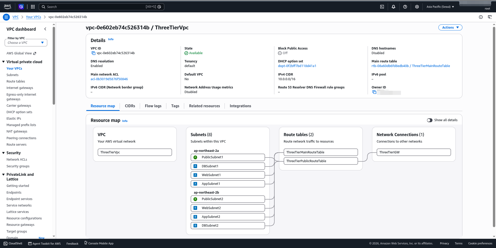 |
| Eight subnets in two AZs |  |
| VPC resource map | 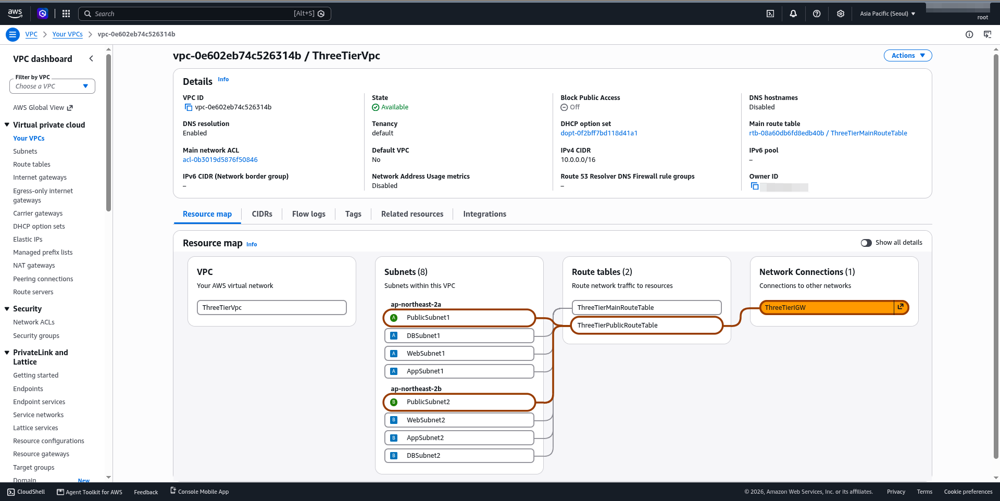 |
| Public route to Internet Gateway | 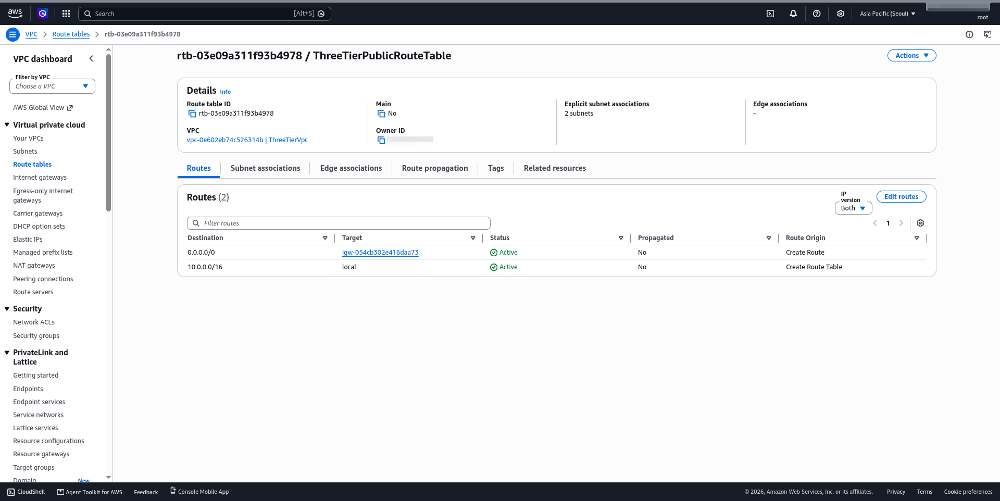 |

### Security
| | |
|---|---|
| All security groups | 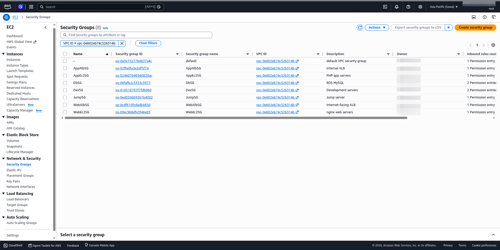 |
| Chained inbound rules |  |

### Database
| | |
|---|---|
| DB subnet group | 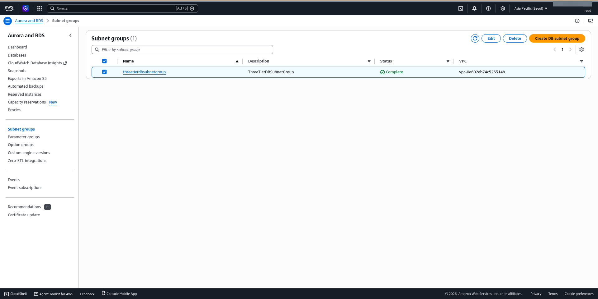 |
| RDS available, public access = No | 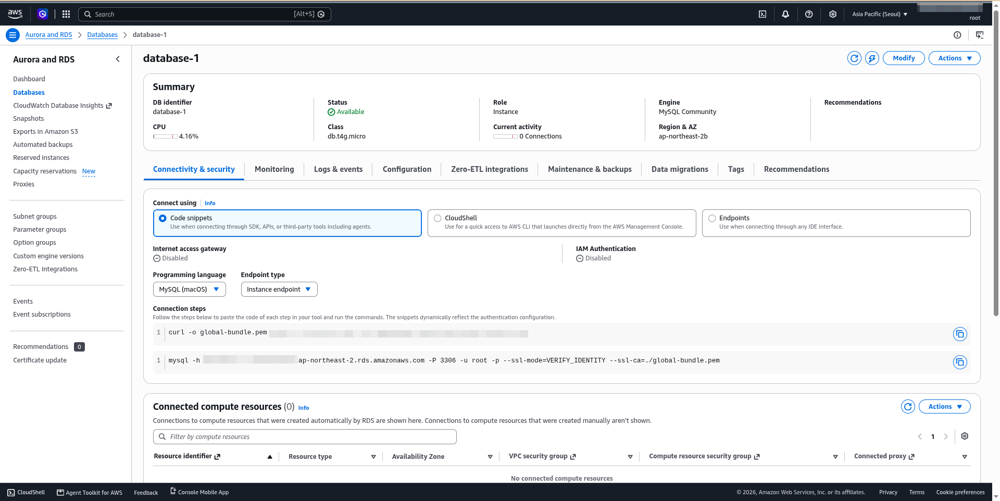 |
| JumpServer running | 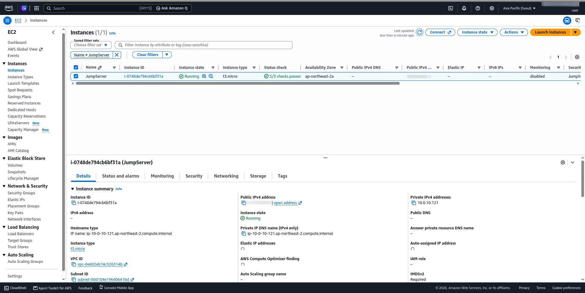 |
| MySQL connected, `users` table | 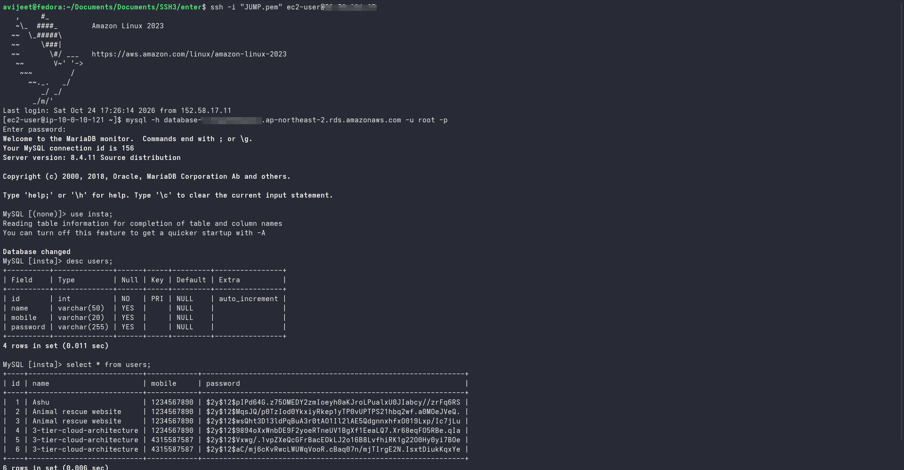 |

### AMIs, Auto Scaling and Load Balancers
| | |
|---|---|
| phpami and webami | 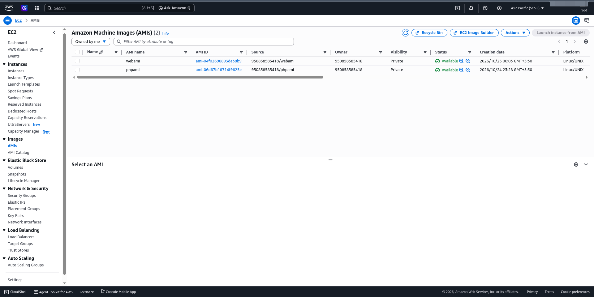 |
| App Auto Scaling Group | 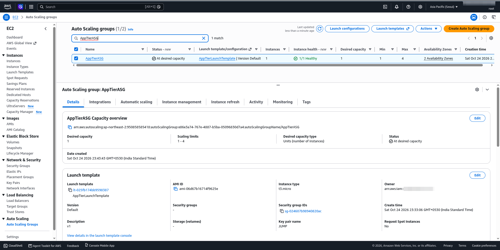 |
| Internal ALB | 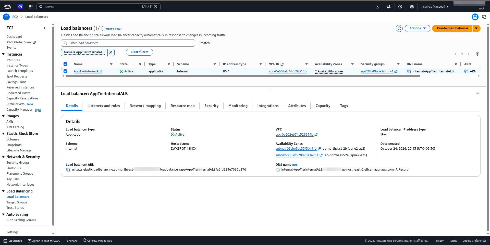 |
| App target group healthy | 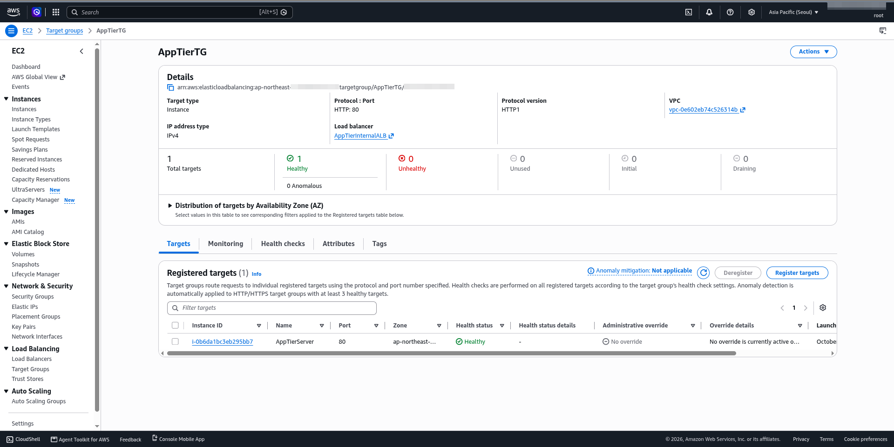 |
| Web Auto Scaling Group | 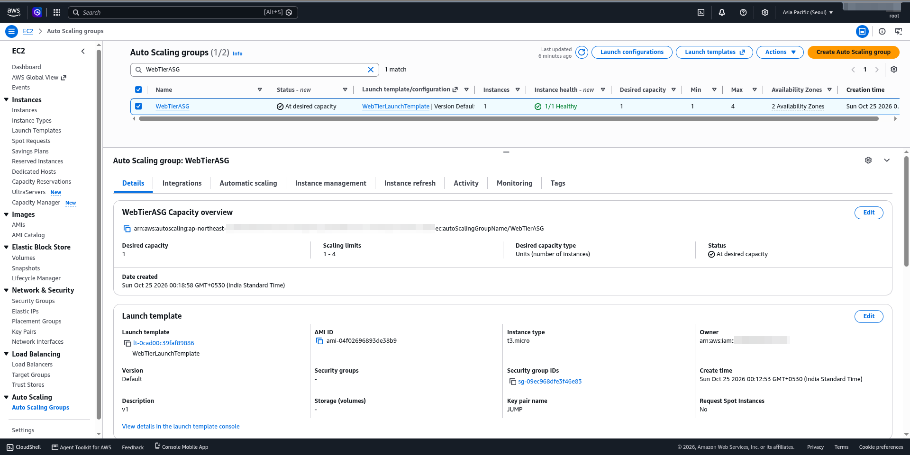 |
| Internet-facing ALB | 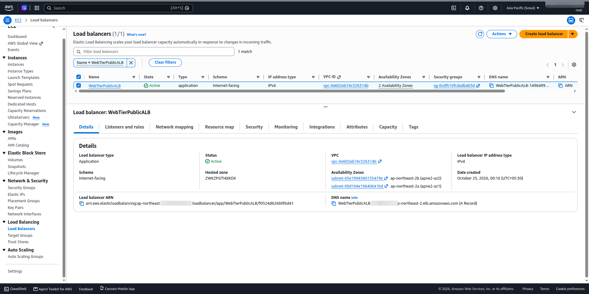 |
| Web target group healthy | 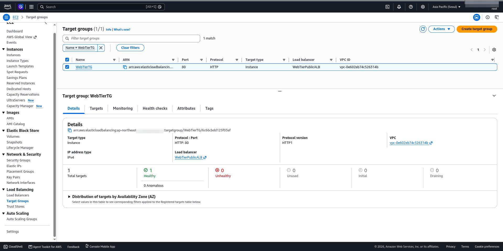 |

### Testing
| | |
|---|---|
| Form served through the ALB | 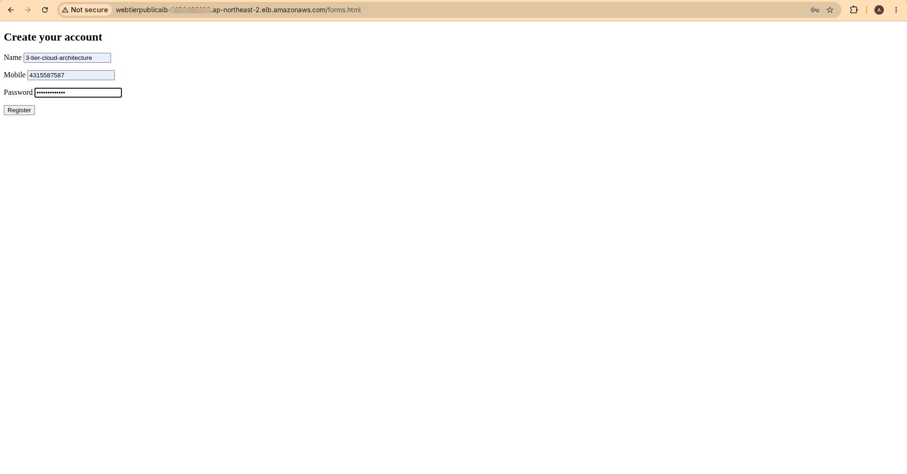 |
| Registration successful | 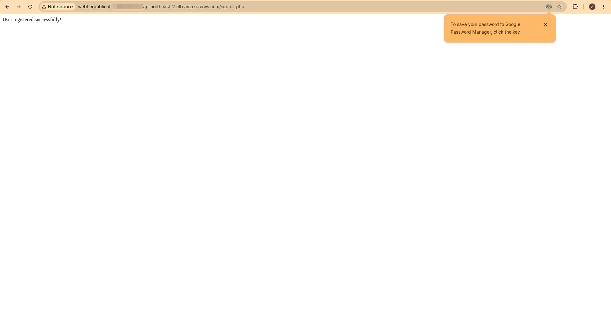 |
| Row saved in RDS (hashed password) | 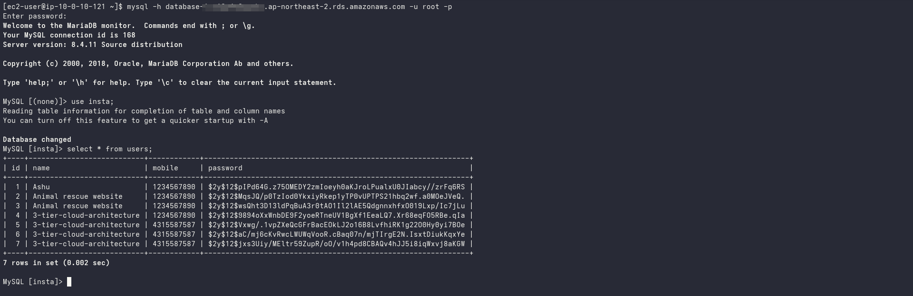 |
| Servers running in both AZs | 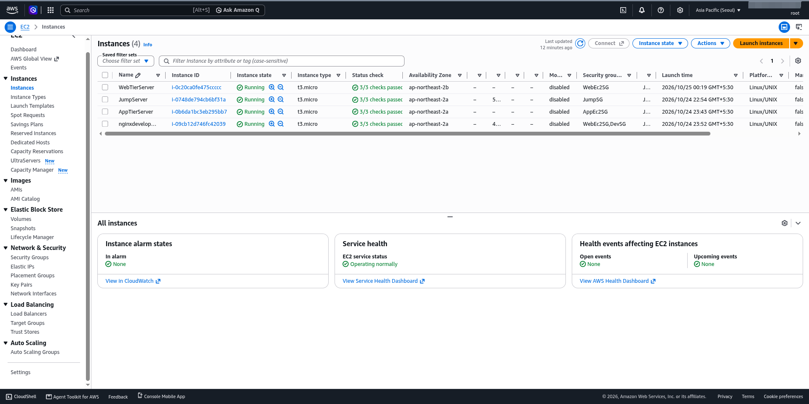 |

## 7. Problems I faced and what I learned

> Add 3 to 5 of your own real problems here. Employers like this part the most. Use this format:

- **Problem:** (what went wrong, for example targets showing Unhealthy)
- **Why it happened:** (the root cause in your own words)
- **How I fixed it:** (what you checked and changed)

What I learned:
- Why each tier needs its own security group, with another security group as the source instead of an IP address
- Why servers are built from AMIs and never changed by hand
- How health checks and Auto Scaling replace broken servers on their own
- Why the database sits in private subnets with no public access

## 8. Limitations and future improvements

Being honest about the lab version:

- **RDS is Single-AZ** in this lab to stay in the free tier. Production should use **Multi-AZ** for automatic failover.
- **The database password is stored in the PHP code** in this lab. Production should use **AWS Secrets Manager**.
- **HTTP only.** Production should add HTTPS with ACM and a custom domain.
- **No NAT Gateway.** Servers get their software from AMIs, so private servers do not need internet access.
- **Next steps:** Terraform for the whole stack, CloudWatch alarms with SNS, and a CI/CD pipeline.

## 9. Clean-up

All resources were deleted after testing to avoid charges: Auto Scaling groups, load balancers, target groups, RDS, AMIs and snapshots, JumpServer, then the VPC.

## 10. Author

**Avijeet Mhaske**
LinkedIn: (add link) | GitHub: (add link)
